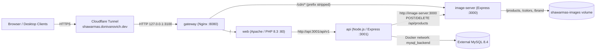

# Architecture

Shawarmas is a multi-client clothing store platform built around a shared TypeScript REST API (`services/api`), a centralized Express image service (`server`), a PHP storefront (`web`), optional Java and WPF desktop clients (`app`, `wpf`), and a MySQL 8.4 database.

## Production topology (Raspberry Pi 5)

In production (`/opt/docker/apps/Shawarmas` using `docker-compose.pi.yml`), a single Nginx `gateway` container is the only service publishing a host port (`127.0.0.1:3100:8080`), fronted by Cloudflare Tunnel (`shawarmas.donivanovich.dev -> localhost:3100`). Neither the CDN nor the API requires a separate public subdomain.

### Gateway routing (`infrastructure/nginx/default.conf`)

| Incoming path | Upstream target | Behavior |
| --- | --- | --- |
| `/` | `http://web:80` | Proxies storefront traffic with `Host`, `X-Real-IP`, `X-Forwarded-For`, and `X-Forwarded-Proto`. |
| `/cdn/<path>` | `http://image-server:3000/<path>` | Strips the `/cdn/` prefix before forwarding (e.g., `/cdn/products/item.png` reaches `/products/item.png`). Preserves `Cache-Control`, `ETag`, and `Last-Modified`. |
| `/cdn/api/*`, `/cdn/health` | Blocked (`404`) | Prevents public exposure of authenticated image upload/delete and internal health endpoints. |
| `/gateway-health` | Local `200 ok` | Used by the `gateway` Docker healthcheck. |

### Network isolation

- **`shawarmas_internal` (bridge):** Connects `gateway`, `web`, `api`, and `image-server`. None of `web`, `api`, or `image-server` publish host ports in production.
- **`mysql_backend` (external):** Attached exclusively to `api` to reach the external MySQL 8.4 instance. `gateway`, `web`, and `image-server` have no database network access.

## Client communication

- **Web storefront (`web`):** Uses `web/api-client.php` over HTTP to `API_BASE_URL` (`http://api:3001/api/v1` inside Docker) for authentication, catalog, cart quotes, checkout, and orders. Never connects directly to MySQL. Builds public image URLs by joining `IMAGE_BASE_URL` (`https://shawarmas.donivanovich.dev/cdn` in production) with relative paths stored in MySQL (`/products/...`, `/colors/...`, `/brand/...`).
- **REST API (`services/api`):** Owns all MySQL queries (`utf8mb4` / `UTF8MB4_UNICODE_CI`), session token persistence (`api_sessions`), role-based authorization, and image management (`POST /api/v1/admin/images/products` and `DELETE /api/v1/admin/images/products/:filename`), talking internally to `IMAGE_SERVER_URL=http://image-server:3000` with `IMAGE_SERVER_API_KEY`.
- **Image server (`server`):** Serves `/products/:filename`, `/colors/:filename`, and `/brand/:filename` publicly (via `/cdn/...` in production) and authenticates `POST /api/products` and `DELETE /api/products/:filename` using `UPLOAD_API_KEY`. Persists product files in the named Docker volume `shawarmas-images` and seeds only missing repository product assets on startup.
- **Java (`app`) and WPF (`wpf`) desktop clients:** Communicate solely over HTTP with the REST API (`API_BASE_URL`) and load images from `IMAGE_BASE_URL` (compatible with both local `http://localhost:3000` and production `https://shawarmas.donivanovich.dev/cdn`). Neither desktop client connects directly to MySQL.

## Local development endpoints (`docker-compose.yml`)

| Endpoint | Purpose |
| --- | --- |
| `http://localhost:8080` | PHP storefront |
| `http://127.0.0.1:3001/health/ready` | REST API readiness & `/api/v1` base for local desktop clients |
| `http://localhost:3000/health` | Image-service health & `/products`, `/colors`, `/brand` |
| `127.0.0.1:3307` | Local MySQL 8.4 container (loopback only) |
