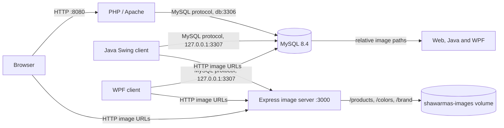

# Architecture

The PHP app uses MySQL for account, catalog, cart and order data. The Java and WPF desktop clients connect directly to MySQL over the host-published loopback port. The image server is shared by all clients; the database stores relative paths such as `/products/item.png`, while `IMAGE_BASE_URL` provides the HTTP origin at runtime.

Compose preserves the MySQL data directory in `shawarmas-db` and image files in `shawarmas-images`. The image service seeds product assets into missing volume paths when it starts. It does not replace existing files. The established retrieval routes and authenticated upload/delete endpoints are documented in [the image server guide](../server/README.md).

## Runtime endpoints

| Endpoint | Purpose |
| --- | --- |
| `http://localhost:8080` | PHP storefront |
| `http://localhost:3000/health` | Image-service health |
| `http://localhost:3000/products/<filename>` | Product/variant images |
| `http://localhost:3000/colors/<filename>` | Color swatches |
| `http://localhost:3000/brand/<filename>` | Brand logo and favicon |
| `127.0.0.1:3307` | Host database connection for desktop apps |

The database is not published beyond the host loopback interface. Inter-container MySQL traffic uses the Compose DNS name `db`.
